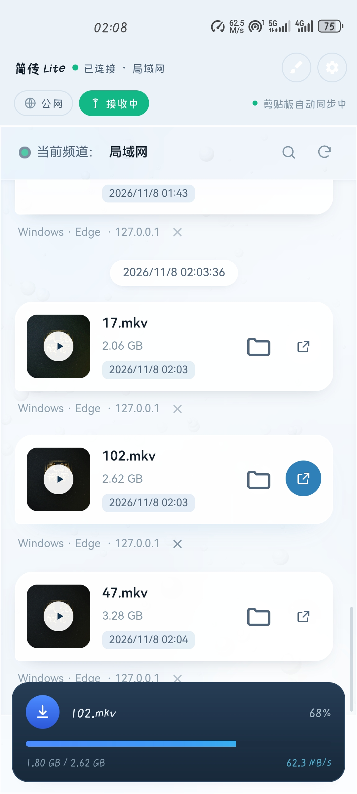
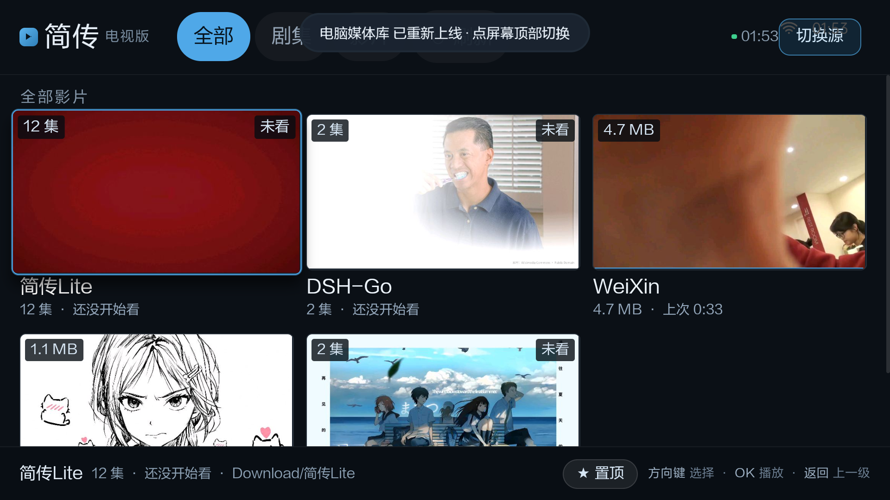
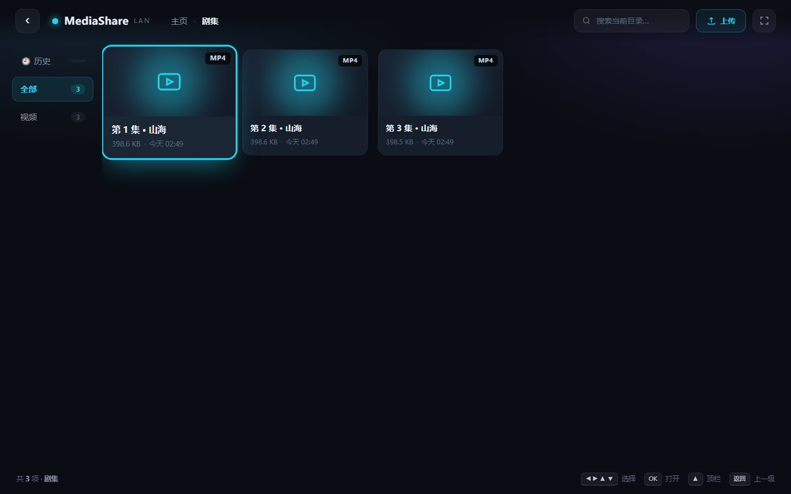
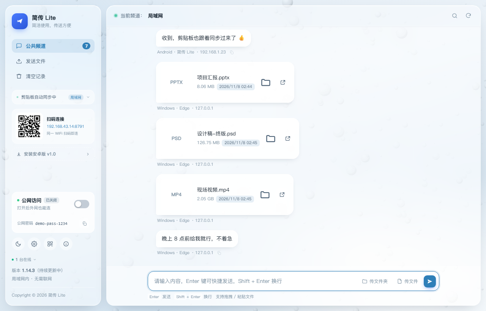

# JianChuan

**Phone ↔ PC over your own LAN: file transfer, clipboard sync, phone-as-server, and
phone videos on the big screen.**

A small self-hosted toolkit for the whole "move stuff between my phone and my computer"
routine — no account, no sign-up, nothing uploaded to someone else's cloud.

<p align="center">
  
</p>

---

## What's inside

| | |
|---|---|
| [1. File transfer](#1-file-transfer) | [4. Phone videos on a TV](#4-phone-videos-on-a-tv) |
| [2. Clipboard sync](#2-clipboard-sync) | [5. Themes](#5-themes) |
| [3. Phone as a file server](#3-phone-as-a-file-server) | [6. MediaShare & TV player](#6-mediashare--tv-player) |

## 1. File transfer

Put the phone and the PC on the same Wi-Fi, open JianChuan on the PC, scan the QR code
on the phone, and drag files either way. Everything goes straight over the LAN, so the
speed is whatever your router can do.

- Drag & drop, file picker, or plain `Ctrl+V`
- 4 GB per file, auto-saved into `Downloads\JianChuan` (configurable)
- Desktop notification on arrival; progress card on the phone
- Keeps receiving with the screen off (foreground service + wake/wifi locks)

Measured: ~40–80 MB/s over Wi-Fi for a 2 GB video, 800 MB/s+ on loopback.

## 2. Clipboard sync

Copy text on the PC, paste it on the phone. Or the other way round. Text stays on the
LAN and never touches a cloud; a hash guard stops the two sides from echoing forever.
WeChat notifications can be mirrored to the desktop as well — LAN only, and they still
arrive with the phone locked.

## 3. Phone as a file server

The phone doesn't need the PC at all: while JianChuan runs, the phone is listening.
Anyone on the same Wi-Fi opens the phone's URL in a browser and can push files to it or
pull files off it — nothing to install on their side.

- QR code + address shown on the phone
- The visitor gets a plain web page; works on iOS, Android, Windows, macOS
- Optional public access: one tap opens a temporary Cloudflare tunnel with a random URL
  and a random 12-character password — close it and it's gone

## 4. Phone videos on a TV

The bundled **Media Library Player** (Android TV) scans the LAN and finds both sources:

| Source | Port | Content |
|---|---|---|
| Phone · JianChuan Lite | 8788 | Videos on the phone, auto-grouped into shows |
| PC · MediaShare | 8848 | Videos in any folder you share |

<p align="center">
  <br>
  <em>One card per show, episode count on the badge, resume point underneath</em>
</p>

- One card per show plus an episode grid — not a pile of filenames
- "Continue watching" remembers the position and follows you across devices
- Pin the shows you actually watch so they stay on top
- Remote: arrows to move, OK to play, Back to go up. In the player, three round buttons —
  **pause / next episode / replay** — and ±10 s on the left/right keys
- libVLC inside: MKV, HEVC, 4K; subtitles, audio tracks, speed, auto-next

<p align="center">
  
  
</p>

## 5. Themes

Five palettes: three light (Morning Mist / Mint / Sunset Glow) for daytime, two dark
(Rainy Night / Dusk Violet) for lights-off viewing. The PC side is one HTML file driven
by CSS variables; the Android side mirrors the same colours natively. Switching never
restarts a service or drops a connection.

<p align="center">
  
</p>

## 6. MediaShare & TV player

<p align="center">
  
  
</p>

**MediaShare** turns a PC folder into a media server on port 8848 using nothing but the
Python standard library: folder browsing, poster thumbnails (ffmpeg optional), search,
history, resume playback, HTTP Range so you can scrub, external subtitles converted to
VTT, audio-track and speed switching, auto-next. A Tkinter console manages the shared
folders, starts/stops the server, shows live logs and a QR code.

The PC side of JianChuan itself is a local Python service plus a web UI (optionally
opened in its own window):

<p align="center">
  
</p>

## Quick start

```bash
# PC side — Python 3.9+, no third-party packages
python pc/server.py                 # port 8787, opens the browser
python pc/server.py --port 9000     # custom port
python pc/server.py --window        # own window (needs pywebview)

# Android side
cd android && ./gradlew assembleDebug

# Media library
cd mediashare && cp config.example.json config.json && python server.py
python 控制台.py                     # GUI console (needs tkinter)

# TV / projector player
cd tvplayer && ./gradlew assembleRelease
```

## Layout

```
jianchuan/
├── pc/              JianChuan PC (HTTP service + web UI)
├── android/         JianChuan Android (transfer / clipboard / server / TV page)
├── mediashare/      Media library server + GUI console
├── tvplayer/        Android TV player (libVLC)
├── screenshots/     Images used by the READMEs
└── docs/            Architecture and usage notes
```

## Privacy

- **LAN only by default.** No accounts, no telemetry, no analytics.
- Files and messages live in `data/` on your own machine; delete the folder and they're gone.
- WeChat mirroring accepts **private LAN addresses only** — public requests are dropped.
- Public access is opt-in: random tunnel URL, random password, expires when closed.
- No secrets, tokens or personal paths are committed; `config.json`, `data/`, `*.apk`
  and `*.exe` are git-ignored.

## Known limits

- The TV player ships `armeabi-v7a` only (built for an older projector) — change
  `abiFilters` for newer hardware.
- The Android APK is `arm64-v8a` only, to keep libVLC from doubling the download.
- Show grouping relies on episode numbers in filenames; messy names may group oddly,
  pinning fixes the order.
- Free Cloudflare quick tunnels get a new domain on every restart.
- Thumbnails need ffmpeg; without it you get file-type icons.

## License

MIT — see [LICENSE](LICENSE).

中文说明：[README.md](README.md)
