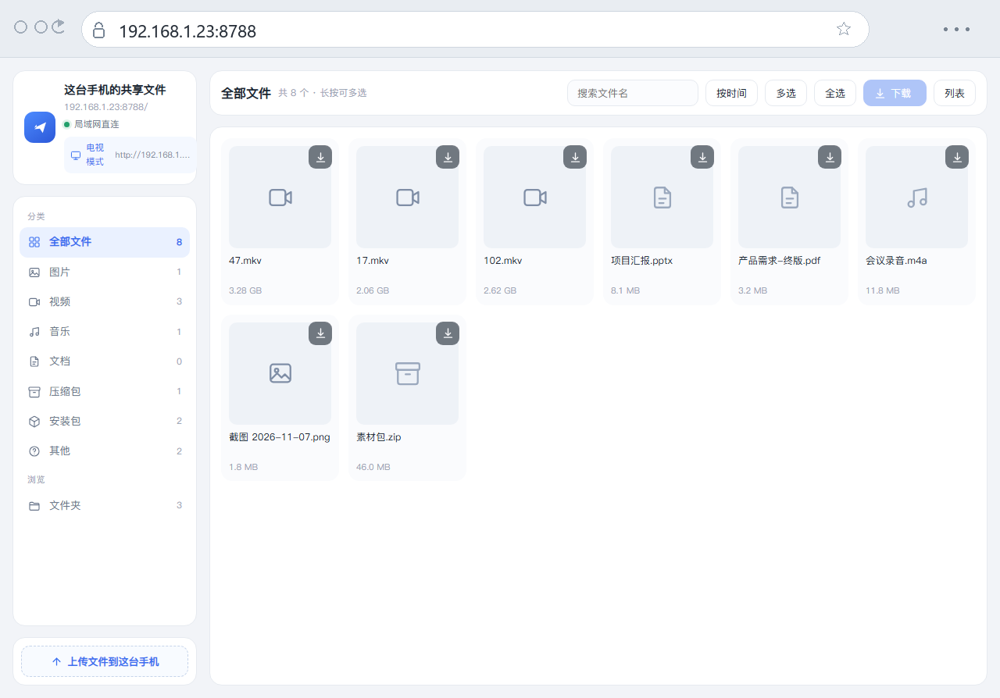
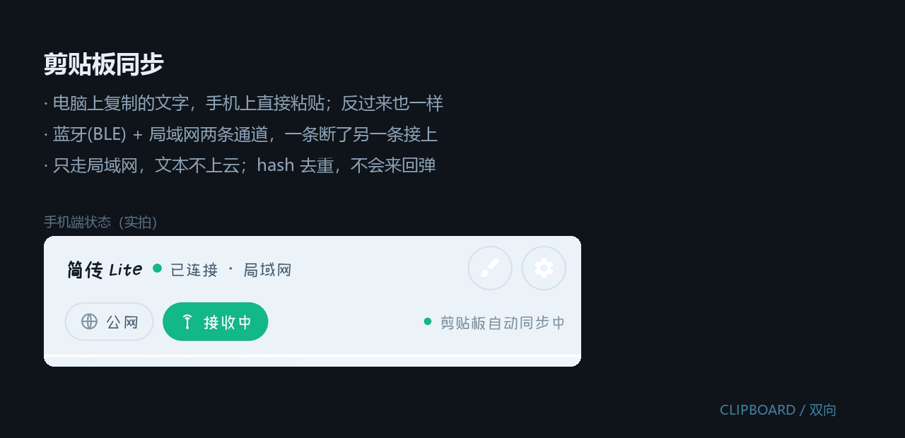
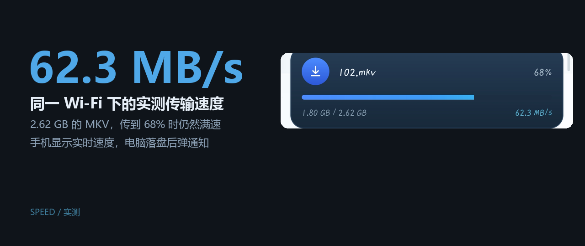
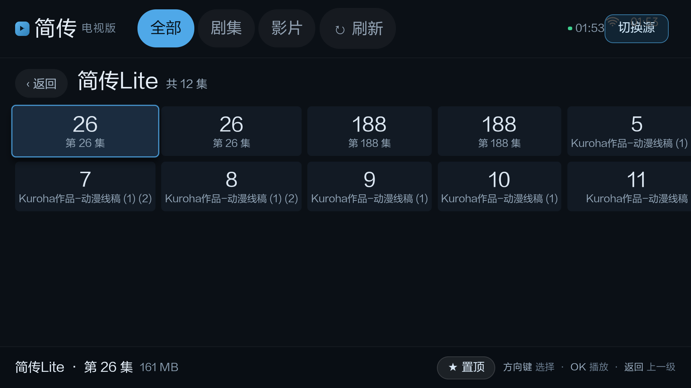
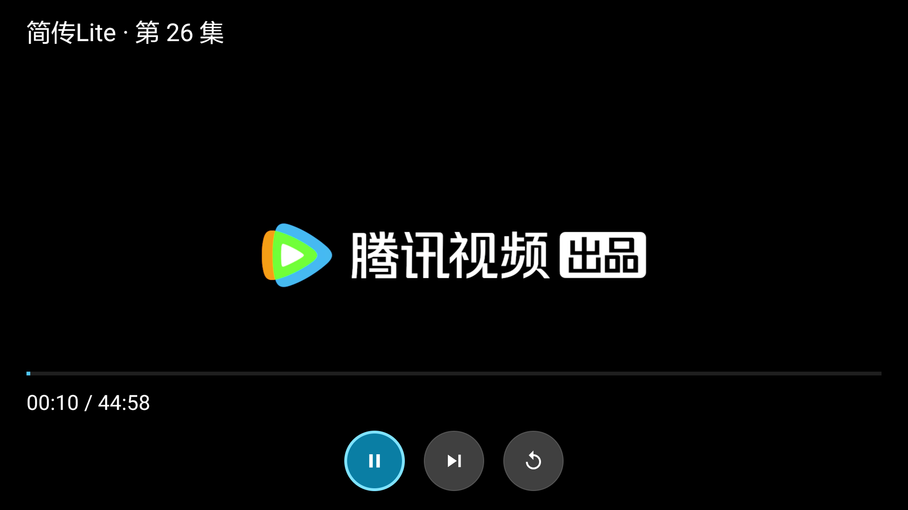
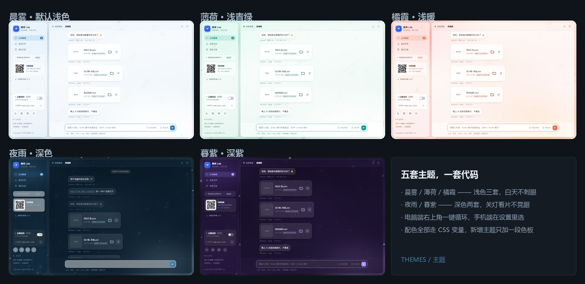
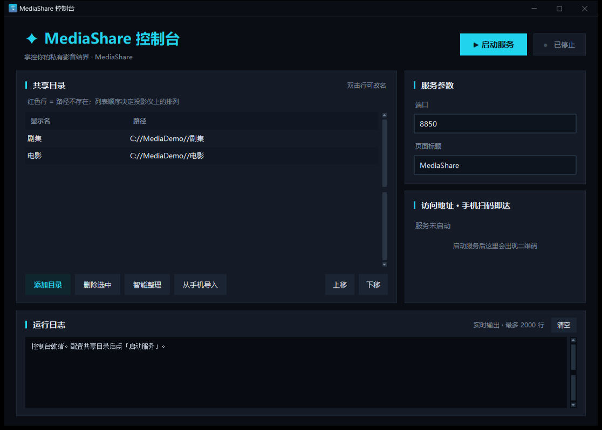

# JianChuan

**Phone ↔ PC over your own LAN: file transfer, clipboard sync (with a Bluetooth fallback),
phone-as-server, and phone videos on the big screen.**

A small self-hosted toolkit for the whole "move stuff between my phone and my computer"
routine — no account, no sign-up, nothing uploaded to someone else's cloud, no relay server.

<p align="center">
  
</p>

---

## Three things to look at first

### 1. Open the phone on a PC — nothing to install

No JianChuan on the PC, no client of any kind, not even your own computer. If it can open a
browser, type the address shown on the phone (or scan the QR code) and you can browse the
phone's files, drag things in, pull things out. **Zero install on the receiving side.**

<p align="center">
  
</p>

What the visitor gets is an ordinary web page: a file list, an upload box, download links.
No plugin, no "please install our app" nag. Windows / macOS / iOS / Android — anything with
a browser works.

### 2. Clipboard sync, with Bluetooth as a fallback

Copy text on the PC, paste it on the phone. Or the other way round. Text stays on the LAN
and never touches a cloud; a hash guard stops the two sides from echoing forever.
If Wi-Fi drops, a BLE channel still carries short snippets across.

<p align="center">
  
</p>

- One switch on the PC, one toggle in the phone's settings
- HTTP as the fast path, BLE as the reliable backup, switching automatically
- WeChat notifications can be mirrored to the desktop — WeChat only, LAN only, and they
  still arrive with the phone locked

### 3. The phone is the server

The phone doesn't need the PC at all: while JianChuan runs, the phone is listening. Anyone
on the same Wi-Fi — a family member's phone, a tablet, a colleague's laptop — can connect
and push or pull files. The phone is no longer just a client; it *is* the server.

- QR code + address shown on the phone, one scan and you're in
- The visitor gets a plain web page; nothing to install
- Optional public access: one tap opens a temporary Cloudflare tunnel with a random URL and
  a random 12-character password — close it and it's gone

---

## What's inside

| | |
|---|---|
| [1. File transfer](#1-file-transfer) | [5. Themes](#5-themes) |
| [2. Phone videos on a TV](#2-phone-videos-on-a-tv) | [6. MediaShare & TV player](#6-mediashare--tv-player) |
| [3. The Android app](#3-the-android-app) | [7. Quick start](#7-quick-start) |
| [4. The desktop app](#4-the-desktop-app) | [8. Build / layout / privacy / license](#8-build) |

## 1. File transfer

Put the phone and the PC on the same Wi-Fi, open JianChuan on the PC, scan the QR code on
the phone, and drag files either way. Everything goes straight over the LAN, so the speed is
whatever your router can do — no relay, no quota.

<p align="center">
  
</p>

Measured: **40–80 MB/s** over Wi-Fi for large files (the screenshot above reads 62.3 MB/s),
800 MB/s+ on loopback. The code was never the bottleneck; rewriting it in a "faster"
language would change nothing you can feel.

- Drag & drop, file picker, or plain `Ctrl+V`
- 4 GB per file, auto-saved into `Downloads\JianChuan` (configurable)
- Desktop notification on arrival; progress card on the phone
- Keeps receiving with the screen off (foreground service + wake/wifi locks)
- Folders are zipped on the fly and sent through the same channel

## 2. Phone videos on a TV

Watch the shows and movies already on your phone on a TV or projector, without copying
anything around.

The bundled **Media Library Player** (Android TV) scans the LAN and finds both sources:

| Source | Port | Content |
|---|---|---|
| Phone · JianChuan Lite | 8788 | Videos on the phone, auto-grouped into shows |
| PC · MediaShare | 8848 | Videos in any folder you share |

<p align="center">
  <br>
  <em>One card per show, episode count on the badge, resume point underneath</em>
</p>

- One card per show plus an episode grid — not a pile of filenames
- "Continue watching" remembers the position and follows you across devices
- Pin the shows you actually watch so they stay on top
- Remote: arrows to move, OK to play, Back to go up. In the player the control strip is
  just three round buttons — **pause / next episode / replay** — with ±10 s on the
  left/right keys
- libVLC inside: MKV, HEVC, 4K; subtitles, audio tracks, speed, auto-next

<p align="center">
  
  
</p>

## 3. The Android app

One app, four jobs: file transfer, clipboard sync, LAN file server, TV media source. The
switch at the top toggles serving mode, the bar at the bottom shows the PC connection, and
the settings page groups permissions and themes.

<p align="center">
  
</p>

- Top switch = serve or don't serve (the reachable address / QR code sits next to it)
- Bottom bar = connection state; tap it to type an address by hand
- One shared progress card instead of a pile of floating popups
- First launch has a three-page onboarding: welcome / keeping it alive in the background / done

## 4. The desktop app

<p align="center">
  
</p>

A local Python service plus a web UI (optionally wrapped in its own window, no console box).
Left rail holds the QR code, the public-tunnel toggle and the theme picker; the centre is the
message stream — text, files, images, zipped folders.

- Pure Python 3.9+ standard library, zero third-party packages
- Listens on the LAN by default; internet exposure is a switch you have to flip
- A 5-second focus heartbeat: notifications only pop when you're actually looking at the window
- Window size and position are stored in `data/config.json`

## 5. Themes

Five palettes: three light (Morning Mist / Mint / Sunset Glow) for daytime, two dark
(Rainy Night / Dusk Violet) for lights-off viewing. The PC side is one HTML file driven by
CSS variables; the Android side mirrors the same colours natively. Switching never restarts
a service, drops a socket or interrupts a transfer.

<p align="center">
  
</p>

## 6. MediaShare & TV player

<p align="center">
  
  
</p>

**MediaShare** turns a PC folder into a media server on port 8848 using nothing but the
Python standard library: folder browsing, poster thumbnails (ffmpeg optional), search,
history, resume playback, HTTP Range so you can scrub, external subtitles converted to VTT,
audio-track and speed switching, auto-next. A Tkinter console manages the shared folders,
starts/stops the server, shows live logs and a QR code.

## 7. Quick start

### Grab a prebuilt binary

The four packages are attached to this repository's **Releases** page:

| Package | Platform | What it does |
|---|---|---|
| `简传Lite-电脑版-*.exe` | Windows x64 | Desktop app — double-click, no Python required |
| `简传Lite-安卓版-*.apk` | Android 7.0+ (arm64) | Phone app: transfer / clipboard / server / TV source |
| `媒体库播放器-*.apk` | Android TV / projector (armv7) | Big-screen player, finds sources on the LAN |
| `MediaShare-电脑版.exe` | Windows x64 | PC as a media server, plus the GUI console |

### From source

```bash
# PC side — Python 3.9+, no third-party packages
python pc/server.py                 # port 8787, opens the browser
python pc/server.py --port 9000     # custom port
python pc/server.py --window        # own window (needs pywebview)

# Android side
cd android && ./gradlew assembleDebug

# Media library
cd mediashare && cp config.example.json config.json && python server.py
python 控制台.py                     # GUI console (needs tkinter)

# TV / projector player
cd tvplayer && ./gradlew assembleRelease
```

Sideload the TV player, launch it and let it scan; if it finds nothing, long-press Back to
type an address by hand.

## 8. Build

| Component | Language / deps | How to build |
|---|---|---|
| `pc/` desktop app | Python 3.9+ stdlib, optional pywebview | `python server.py`; package with `pyinstaller 简传Lite.spec` |
| `android/` Android app | Kotlin 1.9 / AGP 8.7 / minSdk 24 | `./gradlew assembleDebug` |
| `mediashare/` media library | Python 3.9+ stdlib, optional ffmpeg | `python server.py`; package with `MediaShare.spec` |
| `tvplayer/` TV player | Java / libVLC 3.6 / minSdk 21 | `./gradlew assembleRelease` |

> The TV player is 32-bit ARM (older projectors), the Android app is arm64 — the ABIs differ,
> don't cross-install them.

## Layout

```
jianchuan/
├── pc/              JianChuan PC (HTTP service + web UI)
├── android/         JianChuan Android (transfer / clipboard / server / TV page)
├── mediashare/      Media library server + GUI console
├── tvplayer/        Android TV player (libVLC)
├── screenshots/     Images used by the READMEs
└── docs/            Architecture and usage notes
```

## Privacy

- **LAN only by default.** No accounts, no telemetry, no analytics.
- Files and messages live in `data/` on your own machine; delete the folder and they're gone.
- WeChat mirroring accepts **private LAN addresses only** — public requests are dropped.
- Public access is opt-in: random tunnel URL, random password, expires when closed.
- No secrets, tokens or personal paths are committed; `config.json`, `data/`, `*.apk`
  and `*.exe` are git-ignored.

## Known limits

- The TV player ships `armeabi-v7a` only (built for an older projector) — change
  `abiFilters` for newer hardware.
- The Android APK is `arm64-v8a` only, to keep libVLC from doubling the download.
- Show grouping relies on episode numbers in filenames; messy names may group oddly,
  pinning fixes the order.
- Free Cloudflare quick tunnels get a new domain on every restart.
- Thumbnails need ffmpeg; without it you get file-type icons.

## License

MIT — see [LICENSE](LICENSE).

中文说明：[README.md](README.md)
