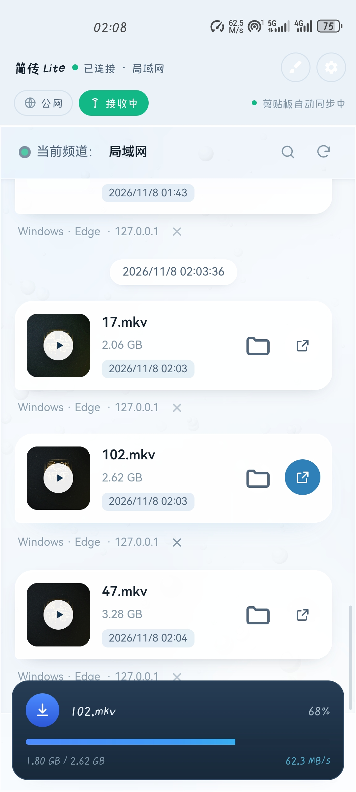
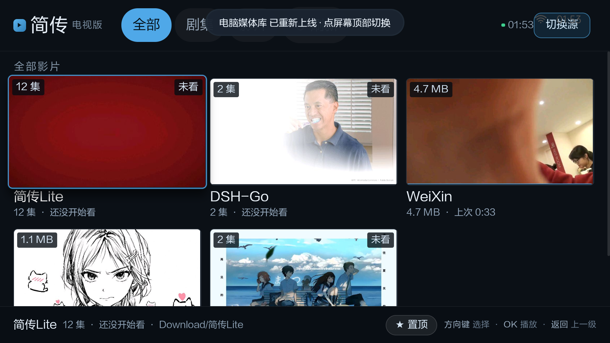
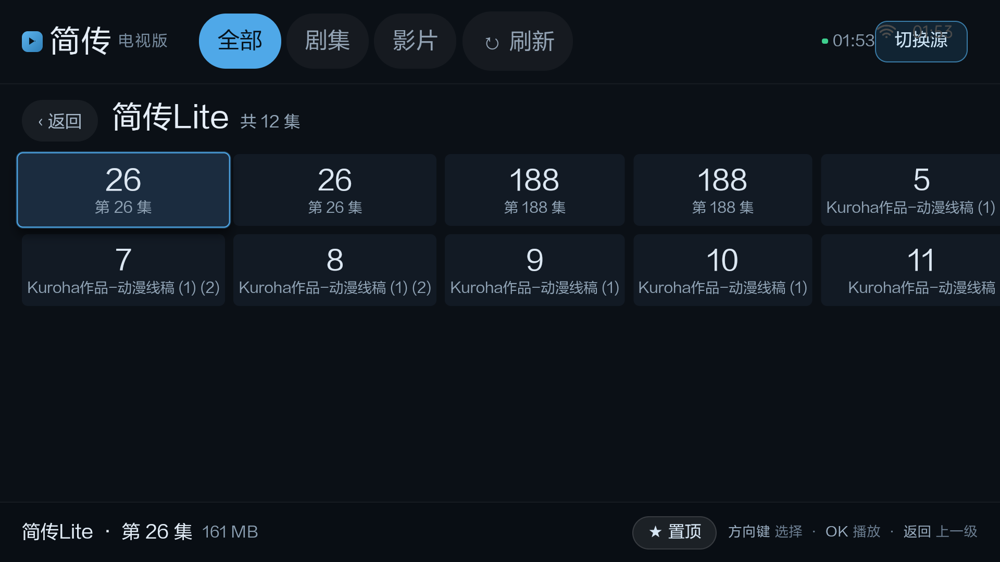
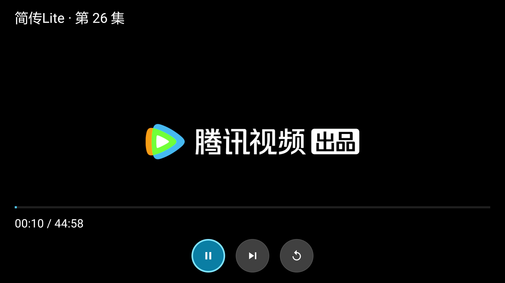
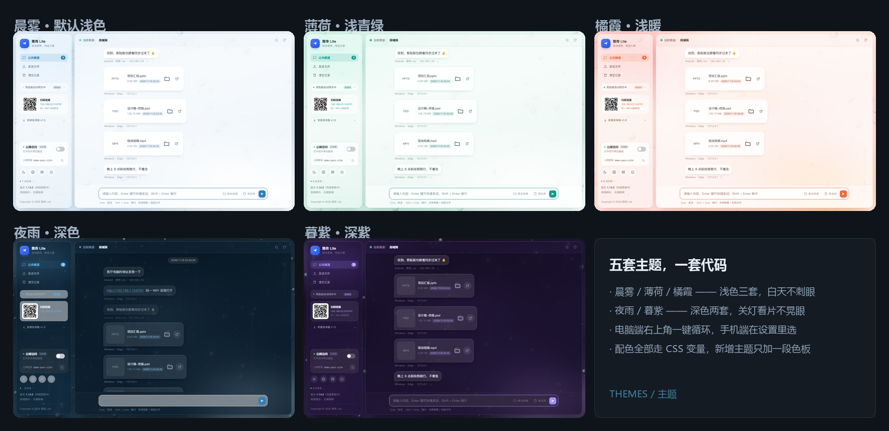
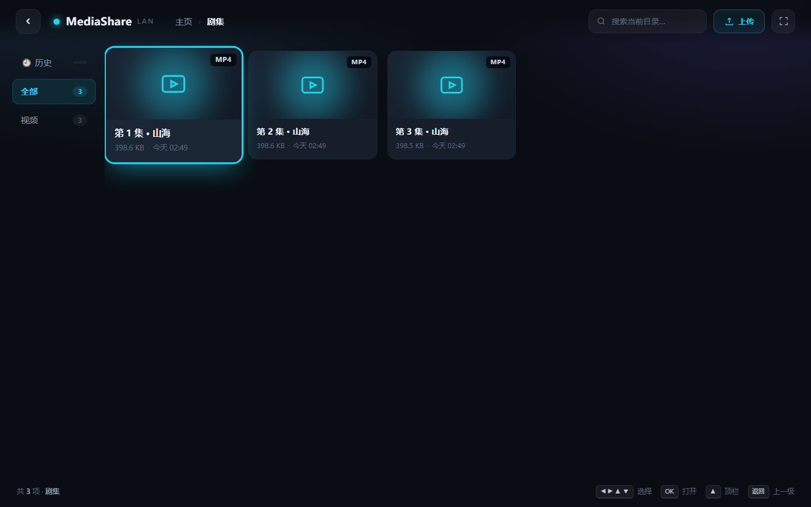
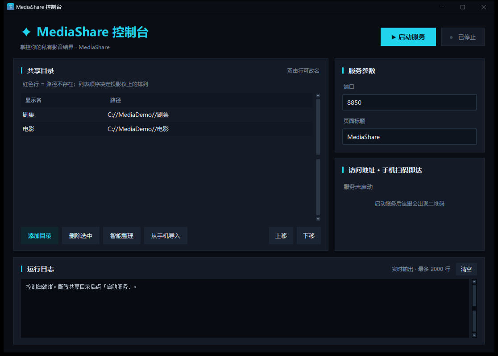
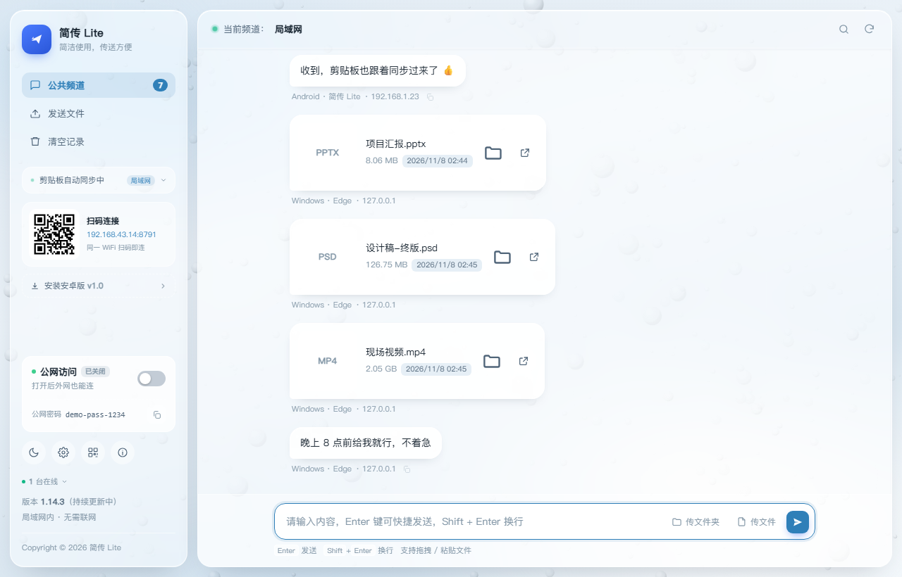

# 简传 · JianChuan

**手机 ↔ 电脑，局域网里传文件、同步剪贴板、把手机视频投到大屏电视。**
一套可以在自己家 Wi-Fi 里跑全流程的小工具：不注册、不登录、不上传云端。

> **JianChuan** is a small self-hosted toolkit that does four things on your own LAN —
> transfer files between phone and PC, sync the clipboard, serve files *from* the phone,
> and play the phone's videos on a TV / projector. No account, no cloud relay.

<p align="center">
  
</p>

---

## 目录 · Contents

| | |
|---|---|
| [1. 手机 ↔ 电脑互传](#1-手机--电脑互传--file-transfer) | [5. 多彩主题](#5-多彩主题--themes) |
| [2. 剪贴板同步](#2-剪贴板同步--clipboard-sync) | [6. 附带的媒体库与投影仪播放器](#6-附带的媒体库mediashare与投影仪播放器) |
| [3. 手机当服务端](#3-手机当服务端--phone-as-a-file-server) | [7. 快速开始](#7-快速开始--quick-start) |
| [4. 大屏电视共享手机视频](#4-大屏电视共享手机视频--cast-phone-videos-to-a-big-screen) | [8. 构建 / 目录 / 隐私 / 许可](#8-构建--build) |

---

## 1. 手机 ↔ 电脑互传 · File transfer

手机和电脑连同一个 Wi-Fi，电脑端开着简传，手机上扫码（或输入地址）就能互发文件。
大文件走的是局域网直连，**速度取决于路由器，不取决于谁家的服务器**；文件不经过任何中转。

实测：同一台路由器下传 2 GB 视频，速度稳定在 40–80 MB/s（Wi-Fi 的上限），
本地回环测试可以跑到 800 MB/s 以上。

- 拖拽 / 点选 / 直接 `Ctrl+V` 粘贴都能发
- 单文件上限 4 GB，自动落盘到 `Downloads\简传Lite`（可改）
- 传完弹桌面通知，手机端有进度卡片，可随时看还剩多少
- 手机熄屏、切到后台也能继续收（前台服务 + WakeLock + WifiLock）

> Phone and PC on the same Wi-Fi. Open JianChuan on the PC, scan the QR code from the
> phone, drag files either way. Transfers go straight over the LAN — no relay server,
> no upload quota. Expect 40–80 MB/s on Wi-Fi, far more on localhost.

---

## 2. 剪贴板同步 · Clipboard sync

在电脑上复制的文字，手机上直接粘贴；手机上复制的，电脑上 `Ctrl+V` 就能用。
**只走局域网**，文本不进任何云端；内容有变化才推，靠 hash 去重，不会来回“打架”。

- 电脑端一键开关，手机端在设置里打开
- 手机端另有 BLE 兜底通道（Wi-Fi 断了也能同步一小段文本）
- 微信通知可以转发到电脑弹窗（只推微信、只走局域网、锁屏也照收）

> Copy on the PC, paste on the phone — and the other way round. Text never leaves the
> LAN. A hash guard suppresses echo loops. WeChat notifications can also be mirrored to
> the desktop, LAN-only, even when the phone screen is off.

---

## 3. 手机当服务端 · Phone as a file server

手机不用连电脑也能当“服务器”：开着简传的手机本身就在监听端口，
**同一个 Wi-Fi 下的任何设备**（别人的手机、平板、同事的电脑）用浏览器打开手机地址，
就能直接把文件拖给手机、或者从手机里下载 —— 不需要在对方设备上装任何东西。

- 手机端显示二维码 + 地址，扫一下就进
- 别人打开的是纯网页，iOS / Android / Windows / macOS 通吃
- 可选“公网访问”：点一下生成临时公网地址（Cloudflare 隧道），人不在家也能传，
  地址和 12 位密码都随机生成，关掉即失效

> The phone itself can act as the server. Anyone on the same Wi-Fi just opens the
> phone's URL in a browser — nothing to install on their side — and can upload or
> download files. An optional one-click Cloudflare tunnel exposes it to the internet
> with a random URL and password.

---

## 4. 大屏电视共享手机视频 · Cast phone videos to a big screen

手机里的剧集、电影，直接在大屏电视 / 投影仪上看，不用拷来拷去。

配套的 **媒体库播放器**（Android TV）会自己扫局域网，同时认出两种源：

| 源 | 端口 | 内容 |
|---|---|---|
| 手机 · 简传 Lite | 8788 | 手机相册 / 下载目录里的视频，自动按剧集归类 |
| 电脑 · MediaShare | 8848 | 电脑上任意共享目录里的视频 |

<p align="center">
  <br>
  <em>一剧一卡，左上角标集数，右下角记着“上次看到哪”</em>
</p>

- 一部剧一张卡 + 选集页，不再是一堆文件名混在一起
- “继续观看”自动记录进度，换设备接着看
- 可以把常看的剧 **置顶**，排在片单最前面
- 遥控器：方向键选、OK 播放、返回上一级；播放页有 **暂停 / 下一集 / 重播** 三个图标按钮，
  左右键快退快进 10 秒
- 内置 libVLC，MKV / HEVC / 4K 都能放，字幕音轨可切、可倍速、可连播

<p align="center">
  
  
</p>

> The Android TV player discovers both sources on the LAN and turns the folder into a
> proper media library: one card per show, an episode grid, resume-watching, pinning,
> and a three-button remote control strip (pause / next / replay). libVLC handles
> MKV, HEVC and 4K; subtitles, audio tracks, speed and auto-next all work.

---

## 5. 多彩主题 · Themes

五套配色，浅色三套（晨雾 / 薄荷 / 橘霞）白天用，深色两套（夜雨 / 暮紫）关灯用。
电脑端是同一份 HTML + CSS 变量，手机端是同一套色号的原生实现，切主题不会重启任何服务。

<p align="center">
  
</p>

> Five palettes, three light and two dark, sharing one set of CSS variables on the PC
> and one set of colour tables on Android. Switching never restarts a service or
> reconnects a socket.

---

## 6. 附带的媒体库、MediaShare 与投影仪播放器

除了手机↔电脑这条主线，仓库里还有两块可以直接用的东西：

### MediaShare（电脑当媒体服务器）

把电脑上的片子共享出来，浏览器、投影仪、手机都能看。纯 Python 标准库，没有依赖。

- 端口 8848，`python server.py "D:\电影"` 就能跑
- 目录式浏览、海报缩略图（ffmpeg 可选）、搜索、历史、继续观看
- 支持 HTTP Range，可以随意拖动进度条
- 外挂字幕自动索引并转 VTT，多音轨 / 倍速 / 自动连播
- **图形控制台**：管理共享目录、启停服务、看实时日志、手机扫码进入

<p align="center">
  
  
</p>

### 简传 Lite 电脑端

<p align="center">
  
</p>

一个本地 Python 服务 + 一个网页界面（可选装成独立窗口）。左栏是二维码 / 公网开关 / 主题，
中间是消息流，支持文本、文件、图片、文件夹打包。

---

## 7. 快速开始 · Quick start

### 电脑端（简传 Lite）

```bash
# 需要 Python 3.9+，无第三方依赖
python pc/server.py                 # 默认 8787 端口，自动打开浏览器
python pc/server.py --port 9000     # 换端口
python pc/server.py --window        # 用独立窗口打开（需要 pywebview）
```

Windows 用户也可以直接双击 `pc/启动.bat`。

### 手机端（简传 Lite Android）

源码在 `android/`，用 Android Studio 打开，或者：

```bash
cd android && ./gradlew assembleDebug
# 产物：app/build/outputs/apk/debug/app-debug.apk
```

装好后打开，顶部开关就是“当服务端”，底部能扫码连电脑。

### 媒体库（MediaShare）

```bash
cd mediashare
cp config.example.json config.json    # 改里面的 roots 指向你的片库
python server.py                      # 默认 8848
python 控制台.py                       # 图形控制台（需要 tkinter）
```

### 投影仪 / 电视播放器

源码在 `tvplayer/`：

```bash
cd tvplayer && ./gradlew assembleRelease
# 产物：app/build/outputs/apk/release/app-release.apk
```

侧载到投影仪，启动后自动扫描；扫不到就长按「返回」键，手动输入地址。

---

## 8. 构建 · Build

| 组件 | 语言 / 依赖 | 构建方式 |
|---|---|---|
| `pc/` 简传电脑端 | Python 3.9+ 标准库，可选 pywebview | `python server.py`；打包用 `pyinstaller 简传Lite.spec` |
| `android/` 简传安卓端 | Kotlin 1.9 / AGP 8.7 / minSdk 24 | `./gradlew assembleDebug` |
| `mediashare/` 媒体库 | Python 3.9+ 标准库，可选 ffmpeg | `python server.py`；打包用 `MediaShare.spec` |
| `tvplayer/` 电视播放器 | Java / libVLC 3.6 / minSdk 21 | `./gradlew assembleRelease` |

> 播放器是 32 位 ARM（老投影仪），简传 APK 是 arm64；两边 ABI 不同，别互相装。

---

## 目录结构 · Layout

```
jianchuan/
├── pc/              简传 Lite 电脑端（HTTP 服务 + 网页界面）
├── android/         简传 Lite 安卓端（互传 / 剪贴板 / 服务端 / 电视页）
├── mediashare/      媒体库服务 + 图形控制台
├── tvplayer/        投影仪 / 电视播放器（libVLC）
├── screenshots/     README 用的截图
└── docs/            架构与使用文档
```

## 隐私与安全 · Privacy

- **默认只走局域网。** 没有账号体系，没有遥测，没有第三方统计。
- 文件与文本都存在你自己机器上（`data/` 目录），清空即走。
- 手机端的微信通知转发**只认局域网地址**，公网 IP 的请求直接丢弃。
- 公网访问是可选功能：需要时才开，地址随机、带随机密码，关掉就失效。
- 代码里不带任何密钥、令牌或你的个人路径；`config.json`、`data/`、`*.apk`、`*.exe`
  都在 `.gitignore` 里。

> LAN-only by default. No accounts, no telemetry, no third-party analytics.
> Optional internet exposure via a random Cloudflare tunnel URL plus a random password —
> off unless you turn it on.

## 已知限制 · Known limits

- 播放器的 ABI 是 `armeabi-v7a`，只为老投影仪编译；新设备请自行改 `abiFilters`。
- 手机端视频归类靠文件名里的集号，命名太乱会归错，手动置顶可以救。
- 公网隧道每次重启都会换域名（Cloudflare 免费版的限制）。
- 媒体库的缩略图依赖 ffmpeg；没装就只显示文件类型图标。

## 许可 · License

MIT，见 [LICENSE](LICENSE)。随便用、随便改，出问题别找我。

---

English version: [README.en.md](README.en.md)
